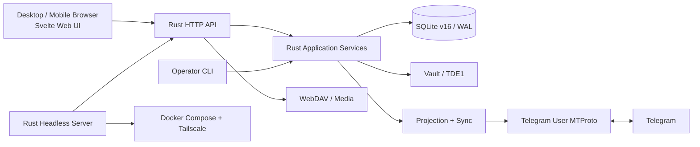

# TDrive Rust Web-only migration

**Plan gate:** Alchemy 2.2 · **Status:** approved plan; no implementation under this plan yet.  
**Project:** `blond11qq/my_telegram_drive` (#89276294) · **Branch:** `refactor/rust-only-cutover-20261122` · **Baseline:** `2397b683c275b504541eebdd5d5556e9e0a79f74`.  
**Stacked Draft MR:** [!24](https://gitlab.com/blond11qq/my_telegram_drive/-/merge_requests/24), target `feat/rust-offline-tde1-cli-20261122`.

> This plan supersedes older GPUI/Android-inclusive plans. They remain historical evidence only; do not execute their GPUI or Android phases.

## Approved product contract (user confirmed 2026-11-23)

- **Only supported interactive client: browser web UI.** Retain existing Svelte/Bun app; connect it to Rust HTTP API. Support desktop and mobile browser viewports; no native client UI.
- **Remove Android, do not port it.** Delete APK project/build scripts and stop future APK builds. Preserve historical GitHub Release assets, device-local data, Telegram sessions and remote Telegram data.
- **No GPUI/native desktop app/WebView wrapper.** No `apps/tdrive-desktop`, GPUI dependency, native window or platform GUI.
- Rust CLI is operator/server-management only (start/stop/status/config/migration/diagnostics/backup automation), not a second end-user UI.
- Headless Rust server + Docker/Compose + Tailscale remain core. Linux Docker amd64/arm64 is primary. Existing macOS/Windows installers are headless server launchers, not GUI clients; keep only when runtime parity and safety are verified.
- Preserve HTTP and WebDAV server contracts. Whether OS-specific FUSE/GVfs/WinFsp adapters must be ported is decided from actual feature inventory; do not silently delete unrelated behavior.
- Remove Go runtime only after every supported Go-owned flow has a verified Rust replacement. Keep Go as oracle until then.
- No merge, deployment, production account/data migration, force-push, or CI runner/mirror/visibility/secret setting changes.

## Final user outcome

A user opens TDrive in a desktop or mobile browser, completes Telegram onboarding, selects a drive, browses/searches folders, uploads/downloads, creates/renames/moves/copies/trashes/restores files, unlocks/locks the vault, previews/seeks supported media, uses retained server protocols, and sees accurate progress/errors. Rust persists state across restart, synchronizes with Telegram and runs headlessly in Docker/Tailscale. Go is no longer needed to build/run/test/package/operate.

**Negative acceptance:** invalid credentials, expired sessions, FLOOD_WAIT, network loss, interrupted transfer, corrupt DB, tampered ciphertext, locked vault, unauthorized requests, path traversal and disk-full fail safely. No plaintext/key/token leak, duplicate destructive write, premature backup source deletion or Go/Rust concurrent writer. CI callback is not proof of compilation, tests or E2E.

## Baseline repository facts

- Current branch HEAD `2397b683c275b504541eebdd5d5556e9e0a79f74`; open Draft MR !24 is at this SHA and targets `feat/rust-offline-tde1-cli-20261122`.
- Tree inventory: **517 tracked Go source files**, **50 Rust source files**, **12 Android packaging/project files** (inventory counts, not completion percentages).
- Root Cargo workspace has types, projection, crypto, config, storage, Telegram, backup, media and inspect crates. `apps/tdrive-mtproto` is a separate Grammers 0.10.0 workspace without a committed nested lockfile.
- No integrated production Rust server/API or browser-connected Rust user flow exists yet. Current Rust crates and MTProto/inbox code are partial foundations, not complete features.
- Android support: `packaging/android/`, `android-apk` in `.github/workflows/installers.yml`, and APK instructions in root/packaging READMEs.
- Effective GitLab CI config: `.gitlab/ci-hub-request.yml@blond11qq/ci-hub-smoke`; shared runners disabled. Baseline pipeline #3100236615 bridge #18261499300 succeeded, downstream #3100236636 was skipped with `github_actions_request` manual. GitHub callback run 45061333830 reports success, but job logs and user-flow E2E were not inspected. Evidence: `dispatch/provider_result`; `jobs_verified=unknown`; `e2e_verified=unknown`.

## Architecture

The web UI is the only supported interactive TDrive client. Server owns one SQLite writer and Telegram session. CLI is operational only. Docker contains no GUI/display server.

Plan self-review: [two-lens plan review](reviews/plan-review.json). The plan review is self-review, not an independent external review.

## Phase sequence

| Phase | Outcome | Kind | File |
|---|---|---|---|
| 00 | Android 제품·빌드 지원 완전 제거 | user_flow | [00](phase-00-android-retirement.md) |
| 01 | Go 기준선·호환성 oracle·실제 CI 증거 | foundation | [01](phase-01-baseline-ci.md) |
| 02 | Rust 실행 기반·설정·SQLite v16 저장소 | foundation | [02](phase-02-rust-foundation-storage.md) |
| 03 | Telegram 사용자 계정 MTProto·세션·전송 | user_flow | [03](phase-03-telegram-mtproto.md) |
| 04 | 17-op TDX1 projection·history/live sync | user_flow | [04](phase-04-projection-sync.md) |
| 05 | TDE1·vault·파일명 암호화 | user_flow | [05](phase-05-crypto-vault.md) |
| 06 | 파일·폴더·revision·업로드/다운로드 | user_flow | [06](phase-06-file-operations.md) |
| 07 | 자동 백업·복구·원본 삭제 안전성 | user_flow | [07](phase-07-backup-recovery.md) |
| 08 | 미디어 Range·썸네일·HLS·remux | user_flow | [08](phase-08-media-preview.md) |
| 09 | WebDAV·마운트·외부 파일 프로토콜 | user_flow | [09](phase-09-webdav-mount.md) |
| 10 | Rust HTTP API와 브라우저 웹 UI 완전 연결 | user_flow | [10](phase-10-http-api-web-ui.md) |
| 11 | Headless Rust server·Docker Compose·Tailscale | user_flow | [11](phase-11-headless-runtime-docker.md) |
| 12 | 보안·성능·운영·패키징·릴리스 | foundation | [12](phase-12-hardening-release.md) |
| 13 | 비파괴 Shadow·격리 Canary·복구 리허설 | user_flow | [13](phase-13-shadow-cutover.md) |
| 14 | 완전한 parity 후 Go source·toolchain 퇴역 | foundation | [14](phase-14-remove-go.md) |

Each phase defines file ownership, acceptance, negative cases, TDD, CI proof, rollback and exit gate. Foundations name their downstream consumer; they are not product completion.

## Global invariants

1. Preserve TDX1 messages, multipart, revisions, tombstones and historical wire compatibility.
2. Preserve TDE1 bytes, KDF, key wrapping and sealed filenames; no silent re-encryption.
3. SQLite migration is snapshot → dry-run → validate → backup → activate; never modify the only user copy.
4. Go/Rust never write to the same data directory or Telegram account concurrently.
5. Ambiguous upload outcomes are reconciled before retry; backup source deletion requires remote receipt + SHA-256 + size verification.
6. Secrets/session/keys/user content never enter logs or CI artifacts.
7. Android APK removal does not delete old release assets or device data.
8. No GPUI/native desktop UI; browser E2E covers desktop and mobile viewport.
9. No production cutover, merge or deploy without separate explicit authorization.

## State and evidence policy

`phase-state.json` uses Alchemy 2.2 and append-only transitions: `not_started → in_progress → implemented → tested → verified → completed`. Track code SHA separately from docs-only SHA. Record `dispatch`, `provider_result`, `jobs_verified`, `e2e_verified` independently. If local execution or provider logs are unavailable, mark unknown/blocked; never invent test results.

## Execution order

Commit this docs-only plan first. Then execute Phase 00 Android retirement as a separate test-first code change. Work one phase at a time, run requirements and security/quality reviews, commit exact evidence and advance only after gates pass. Preserve MR !24 as Draft; no force-push, merge or deployment.
